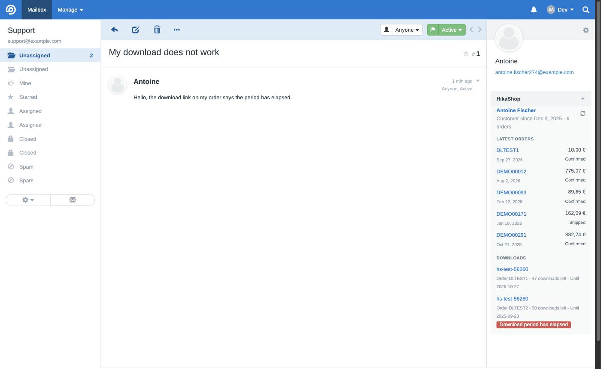

# HikaShop for FreeScout

A [FreeScout](https://freescout.net) module that shows, beside each conversation, who the customer
is in your [HikaShop](https://www.hikashop.com) shop: their latest orders with their totals and
statuses, their downloads and whether they still work, and whatever your other HikaShop
extensions add about them. Each order and customer links to its page in your shop's backend.



It reads the shop through HikaShop's connector API, the one the HikaShop mobile app uses, so there
is nothing to install on the shop.

## Requirements

- FreeScout 1.8.190 or later.
- A shop on HikaShop Business (the connector API ships with it), Joomla or WordPress.
- HikaShop 6.7.0 or later for the downloads and for your extensions' information. Earlier Business
  versions show the customer and their orders.

## Installation

1. Download this repository and put its content in a folder named `HikaShop` in FreeScout's
   `Modules` folder.
2. In FreeScout, **Manage > Modules**, activate **HikaShop**.

## Connecting your shop

1. In the backend of the shop, **HikaShop > System > App Devices**, create a pairing code. Pair it
   with a user who may read orders and customers; the module never writes anything.
2. In FreeScout, **Manage > Settings > HikaShop**, enter the shop's address and the code, and save
   within five minutes. The code is used once: FreeScout receives a token of its own, stored
   encrypted, and the device appears in the shop's App Devices list, where you can revoke it.

A mailbox can have a shop of its own (several brands on one helpdesk): open the mailbox's
settings, then **HikaShop**. A mailbox without one uses the shop of the global settings.

## What it shows

- The customer, with how long they have been one and how many orders they have placed. A sender
  whose address the shop does not know gets a short "no customer" line.
- Their five latest orders: number, date, total in the order's currency, status.
- Sections from the shop: from HikaShop 6.7.0, the customer's downloads, each with the downloads
  left and the end of its period, flagged when it no longer works; and the sections your other
  extensions add through the connector's `onConnectorElementSections` event.

What the shop says about a customer is kept for an hour; the refresh button in the block asks again.

## Privacy

The module sends the shop the email addresses of the customers whose conversations you open, and
nothing else. It receives what the paired user may see of those customers. The token stays in
FreeScout's database, encrypted with FreeScout's application key.

## Developing

`dev/compose.yml` starts a FreeScout with this folder mounted as its module:

```
docker compose -f dev/compose.yml up -d
```

Then open http://127.0.0.1:8096 (not localhost, whose other cookies can make nginx refuse the
request), log in, and activate the module in Manage > Modules. Run artisan inside the container as
its `nginx` user, never as root, or FreeScout can no longer write its cache. The compose file
whitelists `host.docker.internal` so FreeScout may reach a shop on the same machine; never do that
on a real installation.

`python3 dev/test.py` runs the end-to-end tests: it logs into that FreeScout over HTTP, pairs it
with local test shops (a Joomla shop on HikaShop 6.7, one on 6.6, a WordPress one), and checks the
settings pages, the sidebar, the cache, the failures and the permissions. The shops it expects are
listed at the top of the file.

## Licence

AGPL-3.0, like FreeScout. Made by [Hikari Software](https://www.hikashop.com), the makers of
HikaShop.
